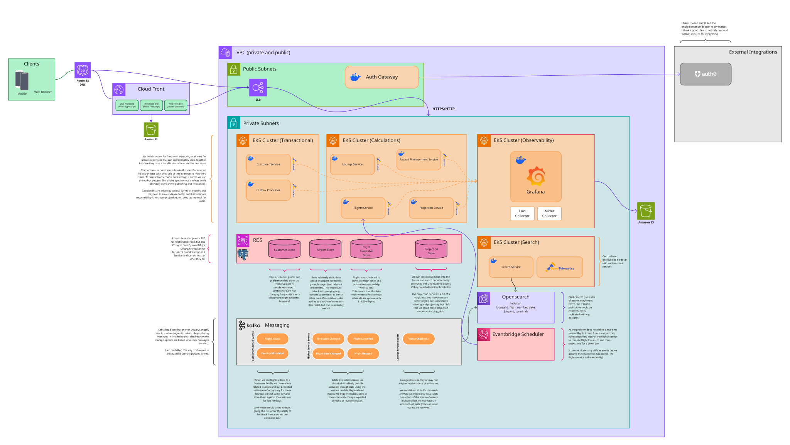

# Airport Lounge Occupancy Prediction
This readme contains some context for the answers to the take home test: assumptions, reasoning, and trade-offs. 

The problem is defined in `test.md`.

The architecture diagram is in `Collinson.svg`, and can be viewed in the [High-Level Architecture Diagram section](#high-level-architecture-diagram) below.

## Chosen Problem
I chose to solve the second problem: a tool to predict airport lounge occupancy.

The first option is mostly a static data problem: shops and restaurants don't change much. The keywords not being from a predefined list adds some complexity, but ultimately it's just grouping keywords by some sort of meaning/similarity. 
Maybe you have a distance metric for keywords, and you can cluster them into groups. Then you can match the user's preferences to those groups. 

The second option solves a more interesting problem. 

Both probably have similar architecture and infrastructures; very little needs to be realtime (a realtime stream of lounge check-in events is great for accuracy, but we should be able to extrapolate from historical data for the most part). 

## AI Use
Using github copilot, I tried both skill-less and few different skills with OpenAI's Sol and Anthropic's Sonnet, but the resulting designs were very bland - like they have been trained on 'Design Lime Bikes' style interview tests. 
I couldn't prompt them to sway their designs towards what I feel is the right representation of this particular problem which at its heart is mostly backend calculations projecting for a lightweight frontend.

The GPT6 release of Sol produced better output but I prompted it as a product problem to help model it to understand if I might want to use anything out-of-the-ordinary to solve the problem. 

Mermaid generation was too time consuming and produced a hard-to-read diagram, hence falling back to Miro where I already had some components I could piece togther for a tender pitch I did.

## Why all this text???
The design is weighted more towards backend calculations and projections, with a lightweight frontend to display the results. The result is kinda a magic-bullet service called the 'Projection Service' which does a lot of heavy lifting, 
but the implementation detail is the inteesting piece, not the fact there is a service that does some projections.

Most of the problem comes down to how we model the data - with predictions being generated from historical data, updated as we learn more about the data we are presenting, and enriched with real-time data where appropriate.

## Problem Framing
The first instinct it to just throw it at Elasticsearch and let the indexing do any heavy lifting, but:
a) there not a lot of data overall (see [By the Numbers](#by-the-numbers))
b) the data is not very dynamic, so we can do a lot of pre-calculation and caching to improve query speed (see [Flights are Scheduled](#flights-are-scheduled))
(see [Scale Assumptions and Estimates](#scale-assumptions-and-estimates) below)
	
The problem *could* be dynamic if we wanted it to be: a stream of check-in events mutates the state of any given lounge, but flights are a somewhat known quantity: we know the number of flights leaving (and arriving if necessary) from a certain 
terminal at an airport, the planes, their seat count, and their departure times. 

Flights are scheduled well in advance - we can use these flight timetables to build up a sound base for our projection as these give us an element of predictability to extrapolate into other days.

Anomalies such as delays and cancellations change lounge demand, so should trigger recalculations, but we can limit the number of those (who cares about how a delay in a flight today changes how long people stay in a lounge tomorrow).

## Scale Assumptions and Estimates
Most of the work happens asynchronously, with the projection service doing the heavy lifting and the frontend just displaying the results. This means we can 

### By the Numbers
Airportia.com tracks ~3600 airports. These might not all have lounges, but it gives a good base measure for overall maximum required scale. 
prioritypass.com touts access to 1900 lounges (and experiences) in 856 airports. There are 44(!) lounges at LHR alone (highest in the world?); some have no lounges. I think a safe assumption for absolute top-end scale is an average of 3 lounges per airport for now.
There are approximately 110,000 flights per day worldwide across the tracked airports. Heathrow operates around 1300 *movements* a day, which includes arrivals and departures.

Individual Lounge Check-Ins are not frequent. Anecdotally, check-in takes a minute or two. Heathrow with 44 lounges, would mean at most 44 check-ins at a time (events might have guest information which adds to occupancy, but assume a single event), 
If there was an infinite queue of people lining up to check-in at all 44 lounges, that is still only 44 events per minute.
If we do assume an average of 3 lounges per airport, and 3600 airports, we have a maximum of 10,800 check-ins per minute or so from geographically distributed airports. The real rate will be no where near this. 

### Flights are Scheduled
Flight numbers are reused and assigned to a specific route (often also the plane so we know specific seat configurations). 
Airlines are assigned to terminals, so we have a predictable number of passengers in a given terminal at a given time (and how many potential lounge users there may be).

We also have historic data at many airports that could allow us to estimate lounge demand. e.g. September 2026 at Heathrow.
- Heathrow had 38,819 movements (arrivals and departures).
- This is an average of 1293 flights per day. If we assume departure to arrival ration of 55:45, that is approx 700 departures. Arrivals will have some impact on lounges (e.g. landing delays resulting in departure delays or gluts of passengers) but not every arriving passenger is going on to a transfer flight.
- There were 7,179,707 passenger movements across those flights. Using the ratio above, that's 132,000 passengers departing per day, or 188 per flight.
- For simplicity, if we assume an even distribution of flights across the 4 terminals, that is ~175 departing flights, 32,000 passengers, per day, per terminal.

### Lounge Usage
Because we don't have check-out data, we can only do a best-guess of how long is a passenger in a lounge (if they are a customer and we have a mobile app, we can possible use geolocation/fencing to provide a more accurate estimate).

The behaviour of passengers something we can only guess at - some will stay longer, some will arrive earlier, some will leave later. We can run a number of (many) simulations to do our best guess at this.
We can use survivor functions (time since entering, time to boarding), passenger type (business, holiday, etc.), flight anomalies (delays, cancellations, etc.), and other factors to estimate dwell time.

### Modelling the data
Because we are projecting occupancy estimates, the model is just our best guess at an output. 
We can use flight number to identify and airport and terminal pair and return the lounges and the estimated occupancy from our calculations. The data is small and could be split geographically by airport into different region stores (or fully replicated across all regions as it's not a lot!)

#### Customer Flights
The number of flights an individual will have on a given day is tiny - most will only have one or two. 
This seems to lend itself to a storage structure that has a copy of all of the customer's flights stored directly against the customer (or at least in the same store) - it means no cross-querying, but the tradeoff may mean many updates if flights change. 
Customer data should be stored in their home regions so that we aren't leaking PII data across borders.

#### Flight Data
We distinguish between Flight Timetables and Flight Instances. Flight Timetables are the scheduled flights, and Flight Instances are the actual flights that occur. We only care about the latter if it might affect lounge demand based on our metrics.
We estimate relationships between lounges and flights through gate approximations (historical data), terminals (airline data), and distance. When timetables change we recalculate any occupancy projections for lounges related to the affected flights.

#### Live Lounge Check-Ins
These only exist as a stream of lounge check-in events. If the throughput of events for a certain partition (airport/terminal paid) indicates the number is outside a statistically significant threshold, we might want to trigger wider updates to occupancy projections.

### High-Level Architecture Diagram

